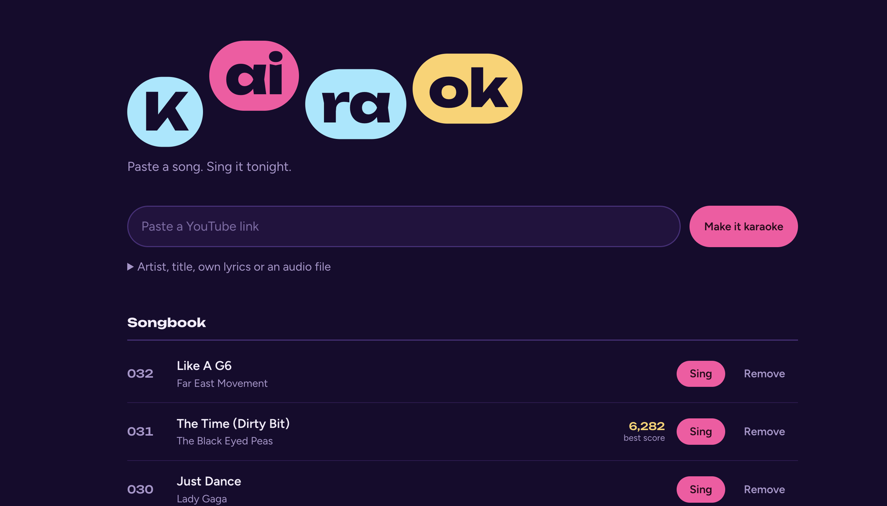
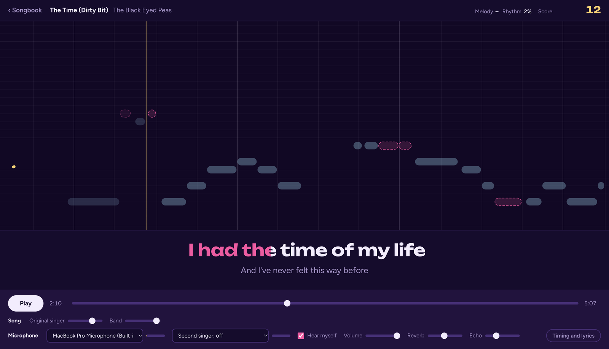

# Kairaok

Turn any song into karaoke. Paste a YouTube link, wait a few minutes, sing.
Kairaok isolates the singer from the band, finds the beat and the melody,
gets time-synced lyrics, and shows the melody as note bars with your own voice
drawn on top, the way the old PlayStation karaoke games did. At the end you
get a score.

**For personal use.** This repository contains only code. It ships no songs, stems
or lyrics. Songs and lyrics are copyrighted: use it with music you are allowed to
copy for yourself, keep what it produces on your own computer, and do not host it
as a public website. Downloading from YouTube may break YouTube's terms of service;
whether you use that part is your decision.

## Screenshots

The songbook: paste a YouTube link, or add a song with your own lyrics or an audio file.



The sing screen: the melody scrolls as note bars, your voice is drawn on top as a gold line, and the lyrics light up word by word.



## Install

Kairaok runs locally on your own computer. It works on:

| Computer | Notes |
|---|---|
| Mac with Apple Silicon (M1 and later) | Fastest: Demucs runs on the Apple GPU |
| Intel Mac (macOS 12 or later) | Runs on the CPU with an older, pinned PyTorch (2.2.2). Expect roughly 2-4x longer per song |
| Linux (x86_64) | CPU by default; uses an NVIDIA GPU automatically if one is installed |
| Windows | Inside WSL2 (Ubuntu), following the Linux steps |

**You need:** git, about 6 GB of free disk space, and conda. If you have no conda
yet, install [Miniforge](https://github.com/conda-forge/miniforge) (free, small):

```bash
# macOS (Apple Silicon or Intel) with Homebrew:
brew install miniforge && conda init "$(basename "$SHELL")"
# or without Homebrew / on Linux: download the installer for your system from the link above
```

Close and reopen the terminal afterwards. Anaconda or Miniconda work too.

**Then:**

```bash
git clone <repository-url> Kairaok
cd Kairaok
./setup.sh      # once: detects your computer and creates the "kairaok" conda environment (2-3 GB download)
./run.sh        # every time: starts the app and opens http://127.0.0.1:8642
```

`setup.sh` picks the right packages by itself. On Intel Macs it applies
`constraints/intel-mac.txt`, which holds PyTorch, NumPy, Demucs and Transformers at
the last versions that still have Intel-Mac builds. On Linux without an NVIDIA
card it installs the smaller CPU-only PyTorch.

**Windows:** install WSL2 (`wsl --install` in an administrator PowerShell, then
restart), open the Ubuntu terminal, install Miniforge for Linux and git there, and
follow the steps above. Open the printed address in your Windows browser. For
singing, the microphone stays in the Windows browser, so nothing special is needed.

## Start

```bash
cd Kairaok
./run.sh
```

Use Chrome or Safari (Firefox works too, but Chrome has the most reliable
microphone handling). The browser asks for microphone access the first time you
open a song. Stop the app with Ctrl+C in the terminal.

The first song takes longer because the Demucs and WhisperX models are
downloaded once (about 1 GB together). After that, expect a few minutes per song
on an Apple Silicon Mac, longer on CPU-only computers.

If YouTube downloads start failing, run `./update.sh` (YouTube changes often and
yt-dlp follows). `python -m kairaok.doctor` inside the environment lists what
is installed and what is missing.

### If setup fails

- **"conda was not found"**: install Miniforge (above) and open a new terminal.
- **WhisperX did not install**: setup continues without it. Songs that have
  time-synced lyrics on LRCLIB still work; timing by ear and the Lyrics score do not.
- **Wrong architecture on a Mac**: setup notices an Intel environment on an Apple
  Silicon Mac (or the other way round) and rebuilds it.
- **Start over completely**: `conda env remove -n kairaok`, then `./setup.sh`.

## What happens to a song

| Step | What | With |
|---|---|---|
| 1 | Download the audio from the link (or read your audio file) | yt-dlp, ffmpeg |
| 2 | Split it into singer and band | Demucs (`htdemucs`), on the Apple GPU when possible |
| 3 | Find tempo, beats and bar starts in the band track | librosa |
| 4 | Trace the melody: loudness of the vocal stem decides how long a note lasts (fading reverb tails are cut), syllable onsets decide where a new note starts, pitch tracking decides its tone | pYIN, onset detection |
| 5 | Get the lyrics and time them (see below) | LRCLIB, WhisperX |
| 6 | Fit notes and words to each other: words move onto the nearest note start, notes are split at word boundaries, and notes in passages without lyrics are dropped | |

Everything is stored in `library/<song id>/`: the two stems as FLAC, plus
`song.json` with beats, notes and timed lyrics.

### Where the lyrics come from

1. **LRCLIB** is searched with artist, title and song length. If a time-synced
   version fits the length of your audio (within 3 seconds), it is used, and
   WhisperX refines it from line timing to word timing.
2. If LRCLIB only has plain text, or its synced version belongs to a different
   cut of the song (a music video with an intro, for example), **WhisperX**
   listens to the isolated vocals and the known text is placed onto what it hears.
3. If there are no lyrics anywhere, WhisperX writes down what is sung. Expect mistakes.

You can always paste your own lyrics (plain text or `.lrc`), when adding a song
or later under "Timing and lyrics" on the sing screen. The same place lets you
correct artist and title and search again, re-time by ear, or shift the lyrics
earlier or later.

## Singing

- **Blue bars** are the melody. The **gold line** is your voice. Where you hit a
  note, the bar turns **mint**. Octaves do not matter: sing where it is comfortable.
- **Pink dashed bars** are spoken or rapped passages. There is no tune to hit, so
  they score on timing: be heard while the bar passes.
- Songs prepared before an update keep their old notes. "Timing and lyrics" has
  "Trace the melody again" to redo them without preparing the whole song again.
- **Original singer** slider: the guide vocal, quiet by default. Turn it to zero
  when you know the song.
- **Hear myself**: plays your microphone through the vocal chain (rumble filter,
  compressor, presence EQ, reverb, echo). It starts off. Switch it on with
  headphones. Over speakers it can feed back.
- **Singing over speakers**: tick this under "Timing and lyrics" so the browser
  filters the song out of the microphone. Headphones give better pitch tracking.
- **Microphone delay**: if your gold line sits a little behind notes you sang on
  time, raise it. Bluetooth gear often needs 150 ms or more.
- Space plays and pauses, the arrow keys jump 5 seconds.

**Two singers**: pick a microphone for the second singer next to the first one.
It can be a separate microphone or "input 2" of the same audio interface (the
first singer then uses input 1 only). The first voice is drawn in gold, the
second in violet, each with its own score; note bars show gold's hits in the
upper half and violet's in the lower half. The Lyrics check listens to the
first microphone only.

**Lyrics position**: under "Timing and lyrics" you can show the lyrics below the
notes, above them, or word by word on the notes themselves.

**Score parts**: next to the total you get *Melody* (while you were singing, how
often you were on pitch), *Rhythm* (did you come in on time for each note and
stay with it) and, after the song, *Lyrics* (WhisperX listens to a recording of
your microphone and counts how many of the words it recognises; the recording is
deleted right after). The lyrics check takes a little while and is only
meaningful with headphones, otherwise it also hears the original singer.

**Score**: every note counts by its length. You get its full value for holding
the right pitch (within one semitone, any octave) for 85% of it. 10,000 is a
perfect song.

## Settings

Environment variables, set before `./run.sh`:

| Variable | Default | Meaning |
|---|---|---|
| `KAIRAOK_WHISPER_MODEL` | `small` | `medium` or `large-v3` hear lyrics better but are slower |
| `KAIRAOK_DEMUCS_MODEL` | `htdemucs` | `htdemucs_ft` separates a bit cleaner, about 4x slower |
| `KAIRAOK_WORD_LEVEL` | `1` | `0` keeps LRCLIB's line timing without the WhisperX refinement |
| `KAIRAOK_SYNC_TOLERANCE` | `3.0` | seconds a synced lyrics file may differ in length and still be trusted |
| `KAIRAOK_PORT` | `8642` | port of the local page |
| `KAIRAOK_LIBRARY` | `./library` | where songs are stored |

## Code map

```
kairaok/
  server.py     local web server and API
  pipeline.py   runs the steps for one song, decides the lyrics route
  download.py   yt-dlp, ffmpeg, guessing artist and title
  separate.py   Demucs
  analysis.py   beats, pitch tracking, notes
  lyrics.py     LRCLIB search, LRC parsing, line and word shaping
  align.py      WhisperX: transcribe, refine, map text onto what was heard, check sung text
  sync.py       fits notes and lyric timing to each other
  doctor.py     install check
web/
  index.html, style.css
  js/app.js     songbook
  js/stage.js   playback, note highway, lyrics, scoring
  js/mic.js     microphone and effect chain
  js/pitch.js   live pitch detection (YIN)
tests/
  test_core.py      checks that need no models
  dev_server.py     runs the app with a synthetic song and no downloads
  make_test_song.py builds that synthetic song
  eval_jamendo.py   compares lyric timing against the JamendoLyrics benchmark
docs/screenshots/   the pictures used in this README
constraints/
  intel-mac.txt     version pins applied on Intel Macs
setup.sh, run.sh, update.sh, _env.sh
```

Run the checks inside the environment with `python tests/test_core.py`.

## Contributing

Pull requests are welcome. Never commit audio, stems, `library/` or lyric files:
`.gitignore` keeps them out, so please do not force-add them.
